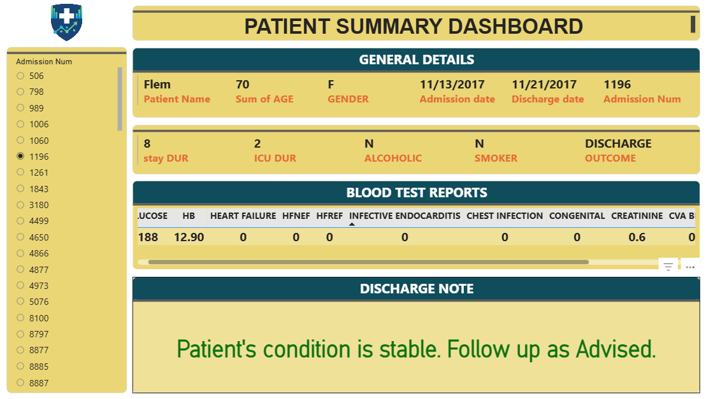

# Patient Summary Dashboard

A one-page Power BI dashboard that summarises patient data: age, gender, last visit, risk score
and visit history, with filters by department, clinician and date.

## Open it

Download `patient-summary.pbix` and open it in Power BI Desktop. To use your own data, go to
**Transform Data**, point the source at your CSV, Excel file or database, then refresh.
